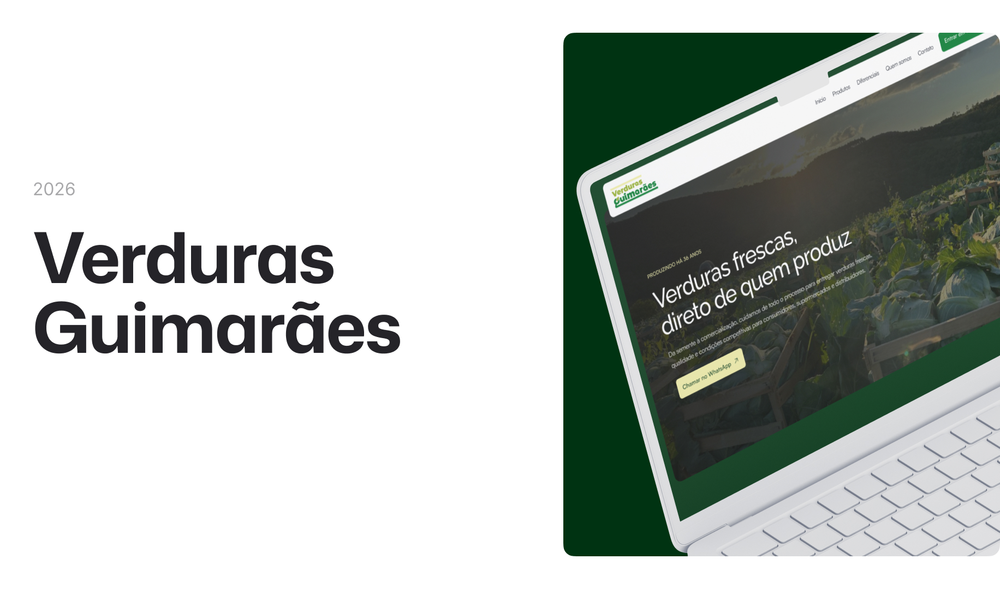

# Verduras Guimarães

O **Verduras Guimarães** é um site institucional desenvolvido em **React**, com o objetivo de apresentar a empresa, seus produtos e diferenciais, além de facilitar o contato com clientes, supermercados e distribuidores.

O projeto foi desenvolvido com foco na criação de uma interface moderna, responsiva e acessível, utilizando componentização, animações, otimização de imagens e boas práticas de desenvolvimento front-end.

---

## 🛠 **Tecnologias e Ferramentas**

Aqui estão as principais tecnologias utilizadas no desenvolvimento deste projeto:

- **React**: Biblioteca para construção da interface e organização dos componentes
- **Vite**: Ferramenta de build e servidor de desenvolvimento
- **TypeScript**: Tipagem estática para maior segurança e organização do código
- **Tailwind CSS**: Estilização da interface através de classes utilitárias
- **Tailwind Variants**: Criação e gerenciamento de variantes dos componentes
- **Motion**: Implementação de animações e transições na interface
- **Git e GitHub**: Controle de versão e hospedagem do código
- **Cloudflare Workers**: Deploy e hospedagem do site

---

## 💻 **Projeto**

Confira abaixo uma prévia e acesse o projeto completo [aqui](https://www.verdurasguimaraes.com.br/):

---

## ✅ **Funcionalidades**

- Apresentação institucional da empresa
- Exibição dos principais produtos comercializados
- Seção com informações sobre produção e experiência no mercado
- Apresentação dos diferenciais da empresa
- Seção sobre a história e atuação da Verduras Guimarães
- Integração com WhatsApp através de mensagem personalizada
- Acesso ao Instagram oficial da empresa
- Navegação entre seções através de links internos
- Menu responsivo para dispositivos móveis
- Animações e transições com suporte à preferência por movimento reduzido
- Componentes reutilizáveis e estilizados através de variantes
- Layout responsivo para dispositivos móveis, tablets e desktops
- Melhorias de acessibilidade e navegação por teclado
- Otimização de imagens e carregamento sob demanda
- Configuração de metadados para SEO e compartilhamento em redes sociais
- Publicação com domínio personalizado e HTTPS

---

## 📝 **Licença**

Este projeto foi desenvolvido para um **cliente comercial**, com finalidade institucional. O uso e a reprodução de elementos da identidade visual, imagens e conteúdos da empresa devem respeitar os direitos de seus respectivos titulares.

---

## 👨🏻‍💻 **Autor**

Feito por **Murillo Ressineti**, aluno da Rocketseat e desenvolvedor Front-end. Conecte-se comigo no LinkedIn para mais informações:

---

## 📬 **Contato**

Se você tiver dúvidas, sugestões ou gostaria de discutir sobre o projeto, sinta-se à vontade para entrar em contato!